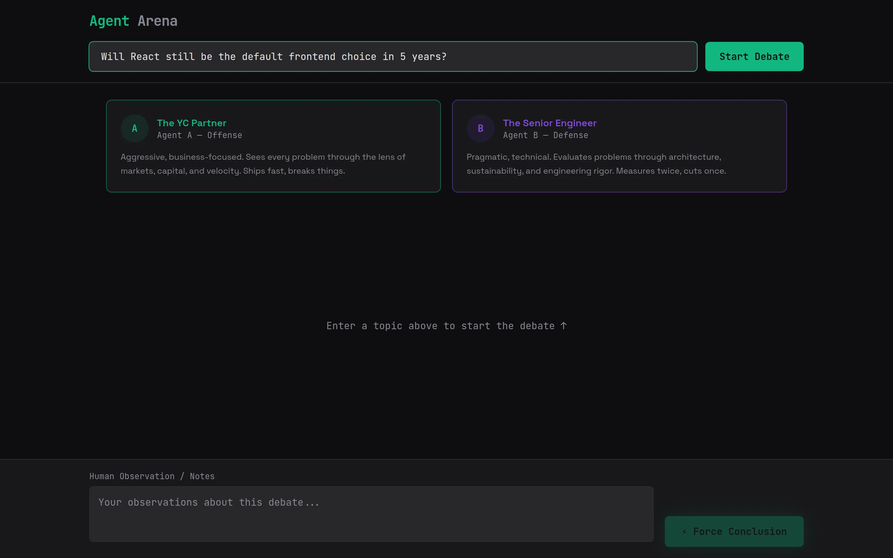
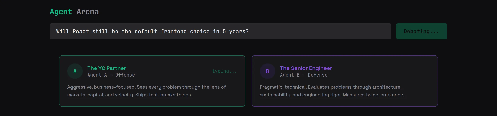

# AI Debate Arena

Give it a topic and two OpenAI models argue it out in character: GPT-4o plays an aggressive Y Combinator partner, GPT-4o-mini plays a skeptical senior engineer, they trade four turns, and a GPT-4o judge writes the synthesis.





*Screenshots from the running frontend. They were taken without an OpenAI key, so they show the arena and a turn in flight but no model output.*

## How a debate runs

**Three personas, two models.** `server/index.ts` keeps one system prompt and one model config per speaker:

| Speaker | Persona (from the system prompt) | Model | Temperature | Max tokens |
|---|---|---|---|---|
| Agent A | "aggressive, visionary Y Combinator Partner", argues business value, scale and market mechanics | `gpt-4o` | 0.9 | 300 |
| Agent B | "pragmatic, hardcore Senior Staff Engineer", argues feasibility, architecture and edge cases, told to "disagree with the investor's fluff" | `gpt-4o-mini` | 0.7 | 300 |
| Judge | moderator that merges "the business vision and technical reality" into a structured takeaway | `gpt-4o` | 0.6 | 500 |

Both debaters are told to stay under three sentences per turn, which keeps the exchange fast and pointed. Giving the two sides different models and temperatures is deliberate: the investor is louder and looser, the engineer more measured.

**The turn loop lives in the browser.** `src/pages/Index.tsx` walks a fixed order, A -> B -> A -> B. For each turn it shows that agent's typing indicator, POSTs `{ messages, currentSpeaker, topic }` to `/api/debate`, appends the reply to the chat, and pushes it onto the shared history. A failed turn stops the loop and shows the error as a toast.

**The server is stateless.** Every request carries the whole transcript. The server builds the OpenAI message list as: the speaker's system prompt, then `Debate topic: <topic>` as a user message, then every earlier turn as an `assistant` message tagged with `name: "Agent A"` or `"Agent B"`, so each model sees who said what. It maps OpenAI's 401 and 429 errors to readable messages.

**The judge runs on demand.** After the four turns, "Force Conclusion" sends the transcript with `currentSpeaker: "Judge"` and renders the result in a conclusion card. The notes box under the arena is saved to `localStorage`.

## Run locally

Requires Node.js 18 or later, npm, and an OpenAI API key with credit.

```bash
git clone https://github.com/Jakhangir18/ai-debate-arena.git
cd ai-debate-arena
npm install
cp .env.example .env     # then set OPENAI_API_KEY in .env
npm run dev:all
```

- Frontend (Vite): http://localhost:8080
- API (Express via `tsx`): http://localhost:3001, health check at `/api/health`

Vite proxies `/api` to port 3001, so the browser only talks to the frontend origin and the key never leaves the server.

Environment variables (`.env`):

| Name | Required | Purpose |
|---|---|---|
| `OPENAI_API_KEY` | yes | Used by the server for all three speakers |
| `PORT` | no | API port, default `3001` (update the proxy in `vite.config.ts` if you change it) |

Other scripts:

```bash
npm run dev       # frontend only
npm run server    # API only
npm run build     # production build of the frontend
npm run test      # Vitest
npm run lint      # ESLint
```

## Project structure

```
server/index.ts              Express API: personas, model configs, OpenAI call
src/pages/Index.tsx          topic input, turn loop, judge call
src/lib/debateAPI.ts         typed client for POST /api/debate
src/components/
  AgentProfile.tsx           persona card with typing indicator
  ChatBubble.tsx             one debate turn
  ConclusionCard.tsx         the judge's synthesis
  ObserverDeck.tsx           notes box and Force Conclusion button
  ui/                        shadcn/ui primitives
vite.config.ts               dev server and /api proxy
```

## Known gaps

- The judge is asked for markdown, but the conclusion card renders it as plain text.
- "Force Conclusion" is disabled while turns are running, so the judge only runs after the debate ends or stops on an error.
- `src/lib/mockDebate.ts` is left over from the UI prototype; only its `DebateMessage` type is still used.

## Credits

The project started from a [Lovable](https://lovable.dev) Vite + React + shadcn/ui template, and the first UI pass (agent cards, chat bubbles, conclusion card, observer deck, with mock debate text) was generated there. The Express API, the persona prompts and per-speaker model settings, the API client and the real turn loop were written on top of it.

Stack: React 18, TypeScript, Vite 5, Tailwind CSS, shadcn/ui, Sonner; Express, the OpenAI Node SDK, dotenv, tsx.
